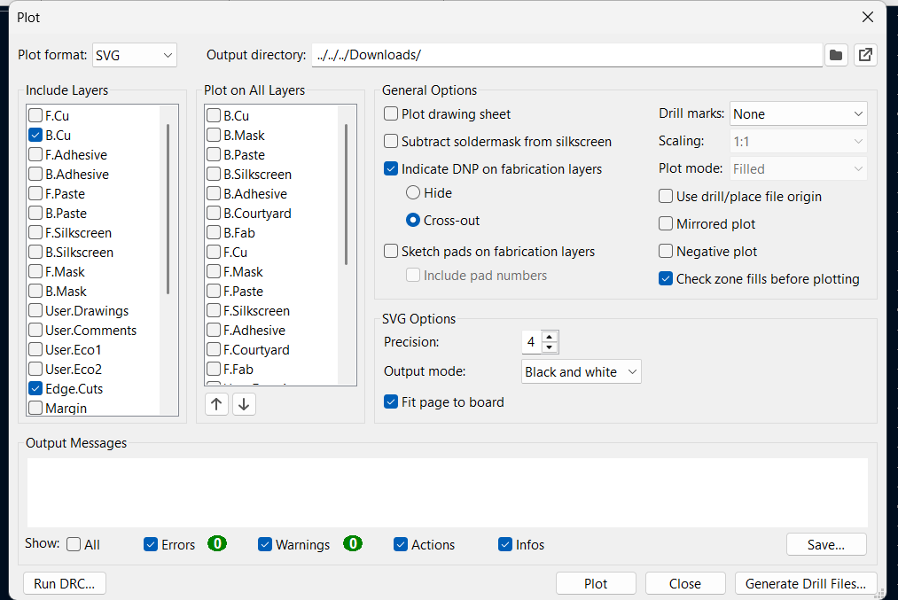

# KiCad SVG → Falcon PNG Dönüştürücü

KiCad'den alınan PCB SVG çıktısını, Falcon Design Space'te lazerle boya kaldırma işlemi için kullanılabilecek negatif PNG görüntüsüne dönüştürür.

## KiCad'de SVG hazırlama

PCB üzerinde gerçek kart ölçülerinde, köşeleri tamamen birleşen kapalı bir `Edge.Cuts` dikdörtgeni bulunmalıdır.

Plot ekranında:

- Plot formatı `SVG` olmalıdır.
- `B.Cu` ve `Edge.Cuts` seçilmelidir.
- Ölçek `1:1` olmalıdır.
- Output mode `Black and white` olmalıdır.
- `Fit page to board` açık olmalıdır.
- `Negative plot` ve `Mirrored plot` kapalı olmalıdır.

## Dönüştürücüyü kullanma

1. `index.html` dosyasını Chrome, Edge veya Firefox ile açın.
2. **SVG dosyasını seç** alanından KiCad'in oluşturduğu B.Cu SVG dosyasını yükleyin.
3. Kartın gerçek genişlik ve yüksekliğini kontrol edin. Gerekirse değerleri elle düzeltin.
4. Çözünürlüğü seçin. Hassas çalışma için `2540 DPI` önerilir.
5. Önizlemede siyah zeminin ve beyaz yolların doğru göründüğünü kontrol edin.
6. **Falcon PNG'sini indir** düğmesine basın.

## Falcon Design Space ayarları

- PNG'nin fiziksel ölçüsünü kart ölçüsüyle karşılaştırın.
- Görüntü/Dolgu Oyma açık olmalıdır.
- Çizgi Oyma kapalı olmalıdır.
- Invert/Tersle kapalı olmalıdır.
- Siyah bölgelerde lazer çalışır ve boya kalkar.
- Beyaz yollar lazerlenmez; boya ve altındaki bakır korunur.

İlk uygulamayı küçük bir test parçasında düşük güçle denemeniz önerilir.

---

© Mert Ali AKÇAY — Yapay zeka araçları kullanılarak tasarlanmıştır.
